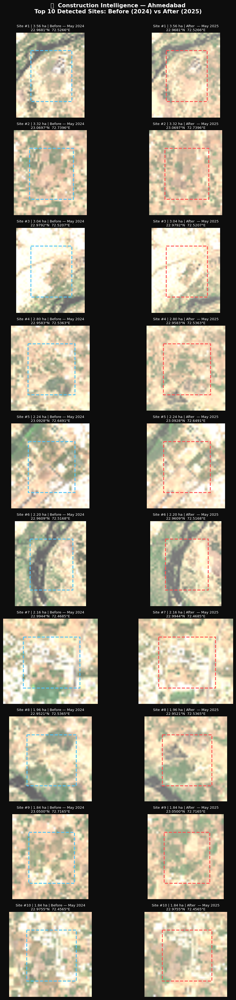

# Construction Intelligence Platform

Finds **new construction sites from free satellite imagery**. The pipeline compares two Sentinel-2 scenes of the same city a year apart, flags land that lost vegetation and gained bare soil, filters out farmland using the road network, and shows the ranked sites on a map dashboard.

Built during my internship at Adani Group (April–May 2026) to spot active construction around Indian cities, starting with Ahmedabad and Surat.



## How it works

```
Sentinel-2 L2A (Microsoft Planetary Computer)
   │  best scene under 20% cloud for a "before" and an "after" window
   ▼
Change detection        NDVI drop > 0.08 AND bare-soil index rise > 0.04,
                        morphological clean-up, connected components → candidate sites
   ▼
Road filter (OSMnx)     distance from each site to the drivable road network;
                        construction sits near roads, farm clearing usually doesn't
   ▼
Scoring                 confidence from road distance, signal strength and site size
                        (uses a trained model in output/model.joblib if present)
   ▼
Geocoding               OpenStreetMap Nominatim names each high-confidence site
   ▼
SQLite + dashboard      FastAPI backend and Next.js map UI; sites can be labelled
                        construction / agriculture / false positive to build training data
```

| Step | Code |
|---|---|
| Fetch and cache bands (blue, red, NIR, SWIR) | `src/pipeline/fetch.py` |
| NDVI/BSI change detection | `src/pipeline/detect.py`, `src/utils/geo.py` |
| Road-proximity filter | `src/pipeline/filter.py` |
| Confidence scoring | `src/pipeline/classify.py` |
| Reverse geocoding | `src/pipeline/geocode.py` |
| API (cities, sites, labels) | `src/dashboard/app.py` |
| Map UI | `dashboard-ui/` (Next.js) |
| Visual verification of the top sites | `src/verify_sites.py` |

## Run it

```bash
python -m venv .venv && source .venv/bin/activate
pip install -r requirements.txt osmnx fastapi uvicorn pyyaml joblib

# detect sites for one city (default windows: Mar–May 2024 vs Mar–May 2025)
python run.py detect --city ahmedabad
python run.py detect --all --before 2024-03-01,2024-05-31 --after 2025-03-01,2025-05-31

# dashboard
python run.py dashboard --port 5000
cd dashboard-ui && npm install && npm run dev      # http://localhost:3000
```

Cities and their bounding boxes are in `config/cities.yaml`. Ahmedabad and Surat are enabled; Navi Mumbai and Pune can be switched on.

## Outputs

- `output/sites.geojson`: detected sites with area, confidence and location name
- `output/construction_sites_map.html`: interactive Folium map
- `output/platform.db`: SQLite database of runs, sites and labels

## Limitations and next steps

- Scoring is a hand-tuned heuristic until enough sites are labelled; the labelling endpoint exists to collect that data.
- Sentinel-2 resolution (10–20 m) misses small plots; sites under about 0.4 ha are dropped.
- Next: train the classifier on labelled sites, and add Sentinel-1 radar so cloudy monsoon months still work.
